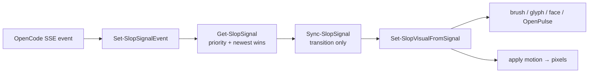

# Sloppy — Showcase

A short technical brief for reviewers. Everything claimed here links to code or a verifier.

## Problem

Coding agents hide their most important states in logs. When an agent is thinking,
waiting on a tool, stalled, or asking for permission, the user is expected to infer it
from scrolling text — and the safety boundary is just as invisible. Sloppy makes those
states first-class and physical: a small desktop companion whose color, shape,
particles, and pulse are derived from the agent's actual condition.

## Approach

Every OpenCode event is normalized and written into a signal store as an event with an
identity, priority, and lifetime. `Get-SlopSignal` in `src/Slop.Motion.ps1` resolves the
base condition plus all live events into one effective signal — lower priority wins,
newest breaks ties. `Sync-SlopSignal` detects real transitions, and
`Set-SlopVisualFromSignal` in `src/Slop.ps1` drives brushes, glyphs, mood, and the
highlight rim. Nothing reads the raw base fields to decide appearance, so the companion
cannot disagree with the agent it represents.

## Three hard problems

### 1. Cancellation that reaches the stream

Stop had to cancel the *reader*, not just the initial HTTP request. In
`src/Slop.Lifecycle.ps1`, `Read-SlopSseStream` uses
`ReadLineAsync(CancellationToken).GetAwaiter().GetResult()`. Passing the token only to
`SendAsync` leaves a blocked `ReadLine` alive after the response headers arrive — the
agent keeps emitting tokens long after the user pressed Stop. A PowerShell delegate
registered on the token was also rejected, because scriptblock delegates need a
runspace the timer thread does not have; the native async API avoids that entirely.

Failure mode prevented: tokens growing 16 → 381 over twelve seconds with the UI stuck
in `streaming` after Stop.

### 2. A permission boundary that survives concurrent turns

`Add-SlopApprovalCard` in `src/Slop.ps1` renders Allow / Allow once / Reject in the chat.
Every handler reads its state from the button's `Tag` rather than closing over function
locals — PowerShell event scriptblocks do not capture locals, and `.GetNewClosure()`
breaks `$script:` references. Each decision carries a generation number and a signal
id, so a late click on an old card cannot approve a newer request, and clearing the
signal releases the sticky amber state. `Reject-SlopPendingApprovals` clears leftovers
on stop and close.

Failure mode prevented: a stale approval leaking into the next generation, or a
permission card that stays visually pending after the request is gone.

### 3. Terminal-event normalization

`src/Slop.OpenCode.ps1` treats `session.execution.succeeded`, `failed`,
`session.execution.interrupted`, and `session.idle` as terminal events, each queueing
`__DONE__`. A rejected permission on OpenCode v2.3.2 emits `interrupted` and **no**
`session.idle`; treating `idle` as the only terminator left Send disabled until the full
timeout. The stream resolver also strips explicit `__TOK__` markers before rendering,
so normalization tests can pass while the live bubble still shows raw deltas.

Failure mode prevented: a rejected approval clearing the card but leaving chat locked,
and literal `__TOK__` prefixes appearing in replies.

## Evidence

- [18-step architecture CodeTour](.tours/architect-slop-architecture.tour) — source anchors are guarded by `tests/slop-tour-check.ps1`
- [Full Pester aggregate](tests/Slop.Tests.ps1) — 522 tests
- [Live UI verifier](tools/verify-motion.ps1) — expand, maximize, send, stream, drag, collapse, with teardown
- [Geometry verifier](tools/verify-geometry.ps1) — 18 scenarios, zero failures
- [Performance baseline](docs/performance/baseline-2026-11-23.md)

Quick start and the signal contract are in the [README](README.md).
